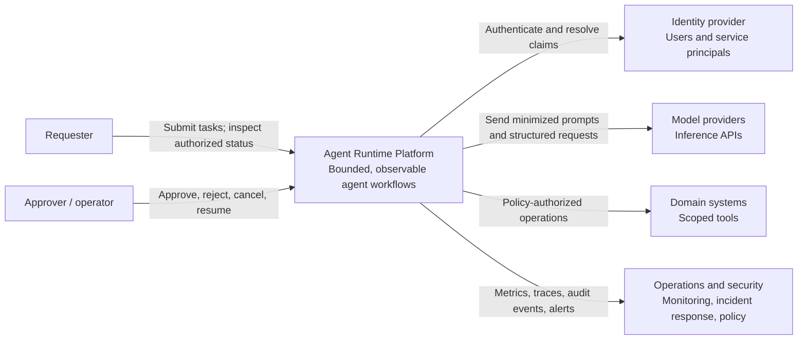
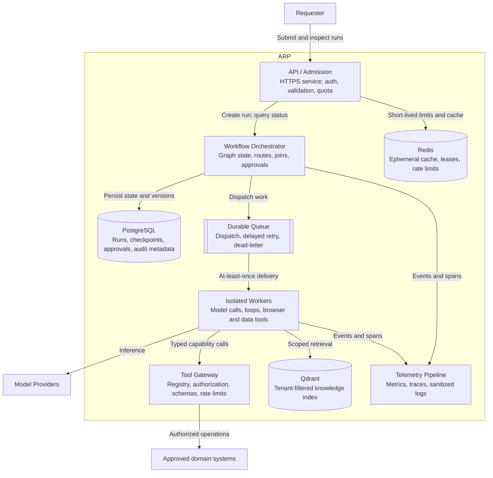
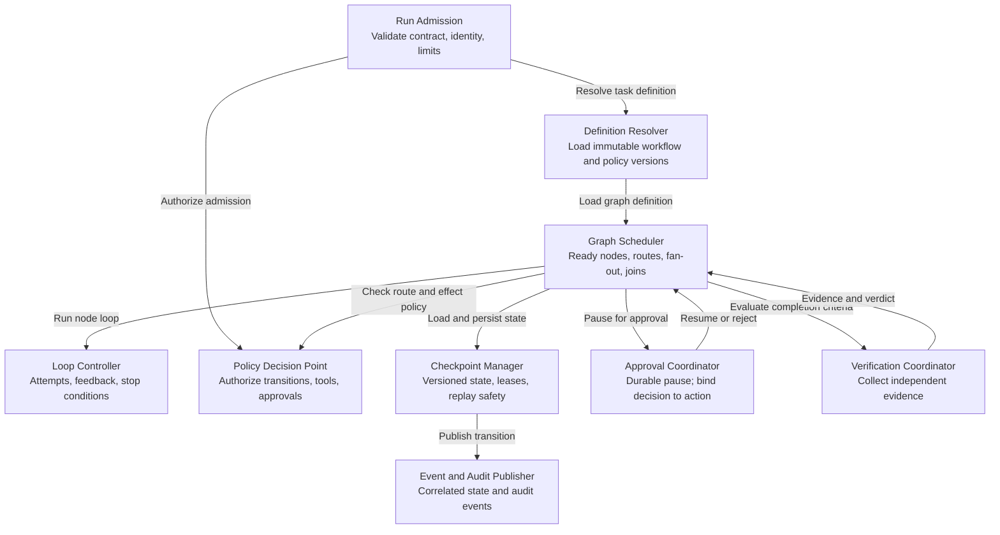
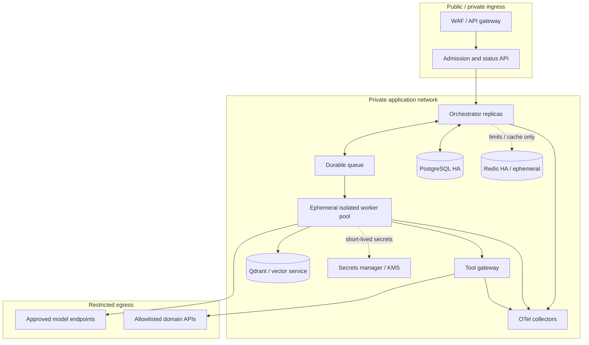
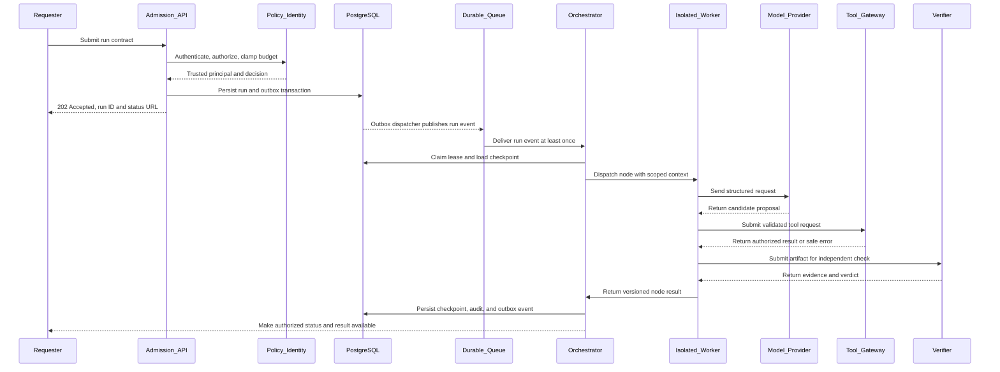
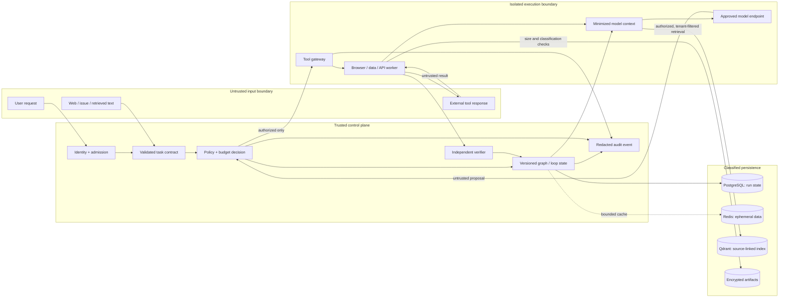
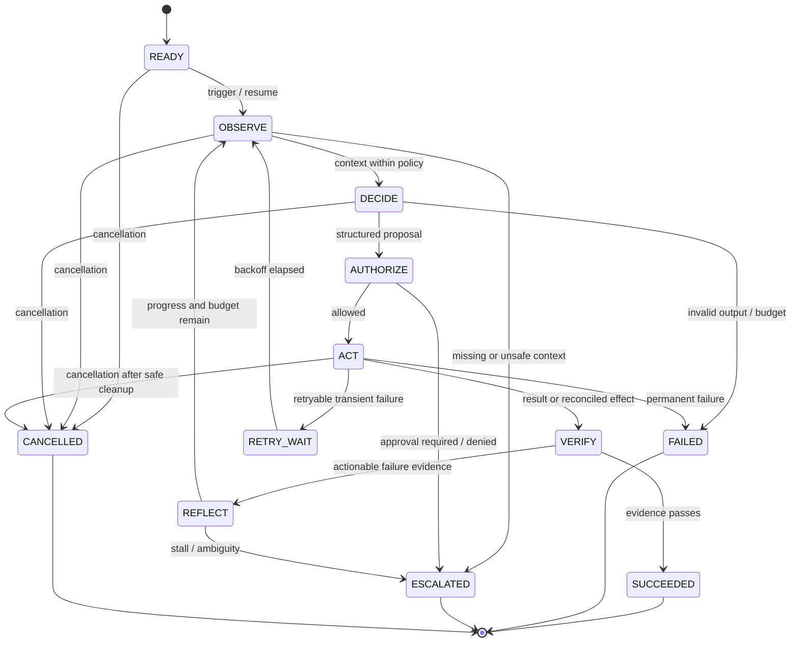
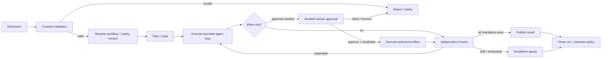
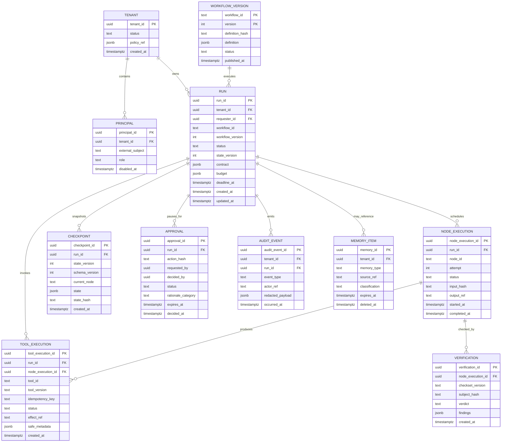
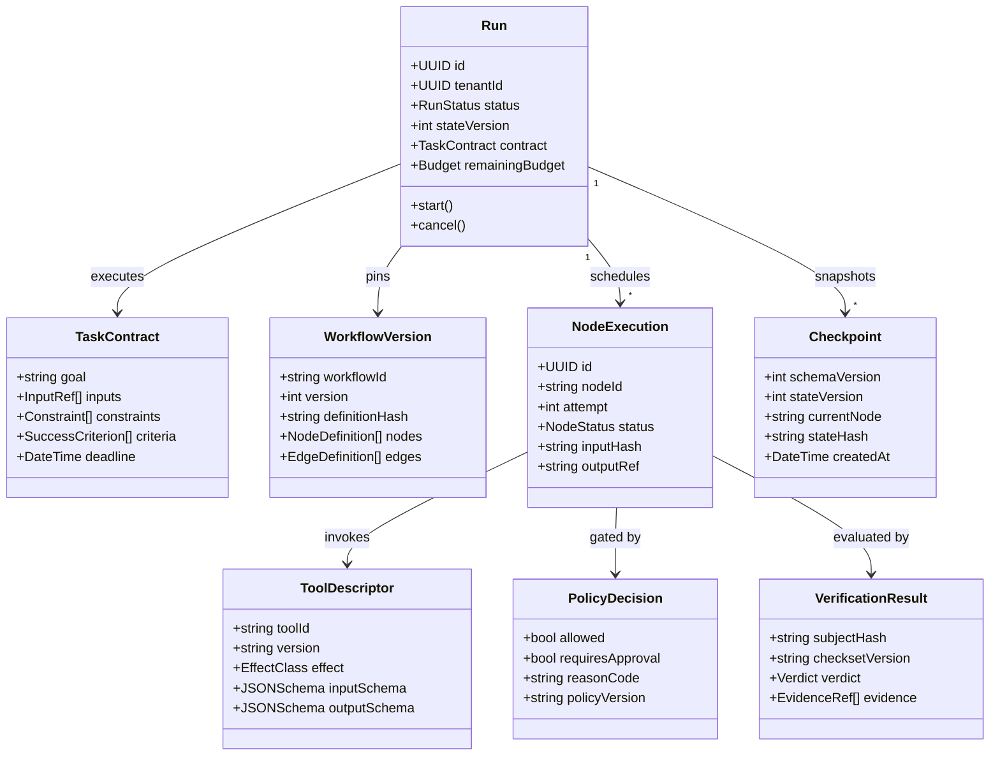

# Agent Runtime Platform — Technical Blueprint

> **Status:** Architecture proposal and implementation target, not a description of a verified deployment. The workspace contains source material and a separately evolving foundation; this document does not assert that any interface, database, control, agent, or operational capability described below already exists. Validate decisions against repository implementation, workload measurements, threat modeling, and the organization’s policies before treating them as commitments.

## 1. Executive vision

### 1.1 Product intent

Agent Runtime Platform (ARP) is a proposed, tenant-aware platform for running bounded AI-assisted tasks. It should make agent execution inspectable, recoverable, and governable by treating the model as one component in a larger system. The platform supplies task admission, policy-gated tools, durable orchestration, state and memory, independent verification, approvals, and operational evidence. Application teams own domain-specific contracts, tools, and success criteria.

The design follows three complementary responsibilities: the **harness** defines the safe operating environment and available capabilities; **loops** govern repeated action, feedback, and stopping; **graphs** specify stages, data contracts, routing, joins, and approval gates. They nest: a harness hosts a graph, graph nodes may run loops, and harness controls apply to all execution. This distinction is explained in the source handbook, *Agent Engineering Foundation* and *Sections 1–3*; the companion `harness_loop_graph.md` frames the same three lenses in its article.

### 1.2 Outcomes and boundaries

**Intended outcomes**

- Run single-agent and multi-stage workflows under explicit identity, budgets, and tool permissions.
- Resume interrupted work without silently duplicating effects.
- Distinguish tool-call completion from task completion; use independent, versioned evidence.
- Route ambiguous, unsafe, stalled, or consequential work to a human.
- Provide per-run provenance and service-level visibility while minimizing stored sensitive content.

**Not goals:** unrestricted autonomous access; a general-purpose model or model-training platform; guaranteed correctness; unrestricted browser/network access; replacing business systems of record; or adopting distributed multi-agent orchestration for every task. The least complex architecture that meets measured quality, safety, and service needs is preferred.

### 1.3 Architecture status vocabulary

Throughout this document, **target** means proposed behavior or an interface to implement; **decision** means a recommended design choice subject to evaluation; **implementation evidence** means repository code, tests, deployed configuration, or operational records that must be inspected before any capability is called implemented. No production-readiness claim is made here.

### 1.4 C4 context view (target; Mermaid 8.8 compatible)



## 2. Requirements

These are proposed, testable requirements. Numeric service targets are initial planning values; confirm them with workload, cost, and risk owners. “Must” denotes a target requirement, not evidence that it is already satisfied.

### 2.1 Functional requirements

| ID | The platform must… |
|---|---|
| FR-01 | Accept a versioned task contract with goal, input references, constraints, expected output, and success evidence. |
| FR-02 | Authenticate API callers and bind a run to a trusted principal and tenant. |
| FR-03 | Reject malformed, oversized, unsupported, or policy-disallowed requests before dispatch. |
| FR-04 | Assign a globally unique run ID and idempotent request key where supplied. |
| FR-05 | Support synchronous submission and asynchronous run execution. |
| FR-06 | Return a stable run status resource and expose authorized status/result retrieval. |
| FR-07 | Support queued, running, waiting-for-approval, succeeded, failed, cancelled, and expired terminal states. |
| FR-08 | Resolve workflow definitions by immutable, versioned identifier. |
| FR-09 | Validate graph topology, schemas, edge targets, and boundedness before activation. |
| FR-10 | Execute deterministic and model-backed nodes under a common execution contract. |
| FR-11 | Permit conditional routing only from validated node outputs and declared routes. |
| FR-12 | Run independent graph branches concurrently within configured fan-out limits. |
| FR-13 | Support explicit `ALL`, `ANY`, quorum, and settled joins with defined timeout/failure semantics. |
| FR-14 | Run a bounded action/observation loop with a per-run maximum turn count. |
| FR-15 | Run a deterministic verification loop against versioned test or policy criteria. |
| FR-16 | Run an evaluator loop using structured rubric results and a calibrated, bounded retry policy. |
| FR-17 | Run a critic/review loop as advisory evidence, never as sole authorization for a consequential effect. |
| FR-18 | Run a recovery loop that reconciles uncertain external effects before repeating them. |
| FR-19 | Stop on success, policy denial, cancellation, deadline, budget exhaustion, stall, or maximum attempts. |
| FR-20 | Propagate cancellation and deadlines to child nodes, model requests, and tools. |
| FR-21 | Persist versioned checkpoints at declared safe boundaries. |
| FR-22 | Resume compatible checkpoints only after validating schema, ownership, expiry, and external preconditions. |
| FR-23 | Use idempotency keys, deduplication, or an outbox pattern for repeatable side effects. |
| FR-24 | Pause durably for an approval or human input, then reauthorize and revalidate on resume. |
| FR-25 | Bind approval to a specific action hash, target, principal, policy version, and state version. |
| FR-26 | Expose tools through a registry with typed input/output schemas, owner, version, risk class, and scopes. |
| FR-27 | Enforce tool allowlists, tenant scope, resource scope, and authorization outside the model. |
| FR-28 | Apply per-tool timeout, request-size, response-size, concurrency, and rate limits. |
| FR-29 | Support read-only and mutating tool classifications with policy-specific approval controls. |
| FR-30 | Provide browser automation through isolated Playwright workers with explicit origin and action policies. |
| FR-31 | Provide MCP connectors behind the same identity, schema, policy, budget, and audit boundary as native tools. |
| FR-32 | Provide API tools with allowlisted destinations, supported methods, validated payloads, and response caps. |
| FR-33 | Provide controlled data tools for approved query patterns, scoped datasets, and bounded result sets. |
| FR-34 | Propagate tenant and principal context to tools without trusting model-supplied identity fields. |
| FR-35 | Enforce isolation between worker processes and tenants, including filesystem and network policy. |
| FR-36 | Retrieve authorized, source-linked knowledge with tenant filters and freshness metadata. |
| FR-37 | Store conversation, run state, durable facts, and audit events as distinct data classes. |
| FR-38 | Support memory provenance, expiry, deletion, correction, and tenant-scoped retrieval. |
| FR-39 | Prevent retrieval from silently widening a run’s permissions or overriding system policy. |
| FR-40 | Provide deterministic input/output schema validation and output redaction hooks. |
| FR-41 | Record structured state transitions, policy decisions, model/tool outcomes, and verification evidence. |
| FR-42 | Correlate logs, traces, metrics, and audit records with run, tenant, workflow, and node identifiers. |
| FR-43 | Emit usage accounting for provider, model, tokens, tool cost, retries, and estimated run cost. |
| FR-44 | Apply run-level, tenant-level, and service-level budgets for time, turns, tokens, tools, and spend. |
| FR-45 | Provide operator controls to cancel, quarantine, retry safely, and inspect failed or stalled runs. |
| FR-46 | Produce an auditable record of approver identity, decision, rationale category, and action version. |
| FR-47 | Support configurable data retention and deletion workflows by data class and tenant. |
| FR-48 | Support versioned prompt, model configuration, tool, policy, and graph references in run provenance. |
| FR-49 | Provide offline evaluation and controlled canary mechanisms before changes affect broad traffic. |
| FR-50 | Export authorized run results and evidence in a documented, versioned format. |
| FR-51 | Support workflow-specific success predicates that are independent of the model’s self-report. |
| FR-52 | Preserve branch-level outputs and provenance and merge them using a declared deterministic rule. |
| FR-53 | Route invalid contracts, policy conflicts, stalled runs, and uncertain side effects to named queues. |
| FR-54 | Apply retries in one designated layer per failure class and honor provider backoff signals. |
| FR-55 | Support tenant-scoped administrative configuration with an auditable change history. |

### 2.2 Nonfunctional requirements

| ID | The platform must… |
|---|---|
| NFR-01 | Target 99.9% monthly availability for admission and status APIs, excluding documented maintenance and dependencies. |
| NFR-02 | Target p95 admission latency below 500 ms for validated requests, excluding external inference. |
| NFR-03 | Expose execution as asynchronous; never hold an API request open for unbounded agent work. |
| NFR-04 | Preserve accepted work across a single application-process restart through durable queue/state mechanisms. |
| NFR-05 | Define and test recovery-point and recovery-time objectives per state and evidence class before production use. |
| NFR-06 | Target at-least-once worker delivery with idempotent node/effect patterns; do not imply exactly-once external effects. |
| NFR-07 | Enforce tenant separation in authorization, storage access, cache keys, queues, retrieval, and observability. |
| NFR-08 | Default to deny for unknown tools, model routes, origins, schemas, permissions, and workflow versions. |
| NFR-09 | Keep authorization deterministic and independently testable without model invocation. |
| NFR-10 | Encrypt service traffic in transit and persistent sensitive data at rest using managed keys and rotation policies. |
| NFR-11 | Store secrets only in an approved secrets manager; issue short-lived scoped credentials to workers. |
| NFR-12 | Avoid placing raw credentials, access tokens, or unredacted secrets in prompts, logs, traces, or memory. |
| NFR-13 | Minimize and classify data sent to third-party model providers; support approved provider/data-residency policies. |
| NFR-14 | Apply retention, legal hold, export, and deletion policies to each persisted data class. |
| NFR-15 | Validate model and tool inputs/outputs against bounded schemas before subsequent use. |
| NFR-16 | Bound request, prompt, context, output, tool result, trace, and stored artifact sizes. |
| NFR-17 | Bound execution wall-clock time, concurrency, retries, fan-out, and spend at both run and tenant level. |
| NFR-18 | Propagate cancellation and deadline signals within a defined interval, targeted at 5 seconds for internal work. |
| NFR-19 | Ensure every mutating tool call has a server-generated or server-validated idempotency identity. |
| NFR-20 | Provide explicit and tested behavior for duplicate events, redelivery, stale checkpoints, and partial branch failure. |
| NFR-21 | Use schema-versioned state and support documented migrations or safe rejection of incompatible checkpoints. |
| NFR-22 | Instrument all critical admission, orchestration, persistence, model, tool, approval, and verification boundaries. |
| NFR-23 | Make operational dashboards and alerts actionable, tenant-safe, and linked to run evidence. |
| NFR-24 | Separate audit records from mutable conversational context; restrict audit mutation and access. |
| NFR-25 | Redact or tokenize sensitive values before observability export, with tested bypass-resistant controls. |
| NFR-26 | Ensure high-cardinality identifiers do not become unbounded metric labels. |
| NFR-27 | Keep raw transcripts and artifacts under stricter access and shorter retention than aggregate metrics by default. |
| NFR-28 | Maintain reproducible workflow, policy, prompt, and tool versions for each run. |
| NFR-29 | Require offline regression evaluations and staged rollout for changes to models, prompts, tools, and policies. |
| NFR-30 | Compare candidate changes with a representative baseline for task success, safety, cost, latency, and escalation. |
| NFR-31 | Define availability and failure semantics for each external provider and connector. |
| NFR-32 | Use circuit breakers, bounded queues, backpressure, and bulkheads to contain dependency failures. |
| NFR-33 | Prevent untrusted issue, web, tool, or retrieved content from becoming trusted instructions. |
| NFR-34 | Isolate browser and code/data execution workers with restricted filesystem and network egress. |
| NFR-35 | Keep network destinations explicit and allowlisted; block metadata and private address ranges unless approved. |
| NFR-36 | Ensure approval is time-bound, action-specific, authenticated, and revalidated against current state. |
| NFR-37 | Provide accessible, documented operator and approval flows with least-privilege roles. |
| NFR-38 | Support horizontal worker scaling without sharing in-memory authority or tenant state. |
| NFR-39 | Define capacity limits and load-test admission, queueing, fan-out, database, and provider saturation behavior. |
| NFR-40 | Avoid single-writer assumptions unless enforced by leases, fencing tokens, or transactional locking. |
| NFR-41 | Maintain documented service ownership, on-call escalation, runbooks, and incident communications before production use. |
| NFR-42 | Produce SBOMs, pinned dependencies, signed build artifacts, and vulnerability-management evidence for releases. |
| NFR-43 | Apply secure development controls, code review, static analysis, dependency scanning, and secret scanning in CI. |
| NFR-44 | Meet applicable privacy, accessibility, records, and regulatory controls selected by the deployment owner. |
| NFR-45 | Provide testable interfaces and contract tests for model providers, tools, workflow nodes, and persistence adapters. |
| NFR-46 | Keep platform core independent of any one model provider’s proprietary tool-call representation. |
| NFR-47 | Make failures diagnosable through stable error codes and sanitized, actionable status details. |
| NFR-48 | Preserve provenance for retrieved facts and verification evidence without treating it as proof of truth. |
| NFR-49 | Maintain bounded, explicit retry policies and prevent retries from multiplying across stacked clients. |
| NFR-50 | Require human escalation when ambiguity, risk, policy, or impact exceeds the task contract’s authority. |
| NFR-51 | Test disaster recovery, backup restoration, deletion workflows, and tenant-boundary controls on a schedule. |
| NFR-52 | Enforce platform configuration changes through review, least privilege, audit, and rollback capability. |
| NFR-53 | Expose cost per successful task and human correction rate, not only raw invocation counts. |
| NFR-54 | Ensure development/test environments use synthetic or explicitly approved data and isolated credentials. |
| NFR-55 | Treat all target service levels and controls as provisional until verified by load, security, and recovery testing. |

## 3. Runtime and harness architecture

### 3.1 Target execution model

The runtime receives an authenticated task contract, resolves an immutable workflow version, constructs minimized context, checks policy and budgets, and schedules durable work. Model decisions are parsed into typed proposals; tools independently authorize and execute effects; outputs are verified; state transitions are persisted and emitted as evidence. Completion is an application decision based on contract-specific evidence—not a model assertion or a successful HTTP response alone.

**Responsibility allocation**

- **Model:** semantic interpretation, candidate plans, summaries, and bounded action proposals.
- **Deterministic runtime:** authentication context, schema validation, policy, state transitions, retry classification, budgeting, scheduling, persistence, and completion gates.
- **Tool gateway / worker:** capability-scoped execution, domain authorization, isolation, validation, timeouts, redaction, and effect reconciliation.
- **Verifier:** independent deterministic checks first, then calibrated semantic evaluation where needed.
- **Human:** decisions outside delegated authority, ambiguous cases, and high-impact approvals.

### 3.2 C4 container view (target; Mermaid 8.8 compatible)



The durable queue product and workflow engine are deployment decisions. Redis is not authoritative for run state, approval decisions, or audit history.

### 3.3 Harness controls

The harness assembles the smallest useful input, including task contract, authorized identity context, workflow/policy versions, relevant retrieved evidence, remaining budget, and prior structured outcomes. It should not expose hidden chain-of-thought or use it as an audit artifact. Middleware order is explicit: authenticate → validate → authorize → minimize/assemble context → invoke model → validate proposal → authorize tool → execute → redact result → persist evidence.

Target control surfaces include per-tenant quotas, per-run budgets, policy and tool registries, secrets brokerage, provider routing, prompt and artifact versioning, data classification, approvals, and observability. Custom application logic may extend these contracts, but may not grant itself broader privilege at runtime.

### 3.4 C4 component view: orchestration service (target; Mermaid 8.8 compatible)



### 3.5 Deployment view (target)



Production deployment, network boundaries, failover, key management, and disaster recovery remain to be designed and verified for the selected hosting environment.

### 3.6 Submission-to-completion sequence (target; Mermaid 8.8 compatible)



### 3.7 Data-flow and trust boundaries (target)



## 4. Five runtime loops

Use loops where feedback can change the next action. Every loop is bounded, persists at safe boundaries, propagates cancellation, and defines stop/error behavior. The handbook’s *Section 2: Loop Engineering* distinguishes feedback, deterministic validation, self-correction, evaluator, and critic loops, and describes bounded retries, idempotency, stall detection, and independent verification; the patterns below apply those principles.

### 4.1 Common loop state machine



### 4.2 Loop A — model/tool action loop

**Purpose:** Choose and execute one permitted action at a time until the contract’s goal is independently verified or a stop condition applies.

```text
function action_loop(contract, state):
    while state.turns < contract.max_turns:
        require_not_cancelled_and_before_deadline(state)
        observation = collect_authorized_observation(state)
        proposal = model.propose(contract, observation, remaining_budget(state))
        validate_schema(proposal)
        decision = policy.authorize(proposal, principal, contract, state.version)
        if decision.denied: return stop_or_escalate(decision.reason)
        if decision.requires_approval: return checkpoint_and_pause(proposal)
        result = tool_gateway.execute(proposal, idempotency_key(state, proposal))
        evidence = verifier.check(contract.success_criteria, result, source_of_truth())
        state = checkpoint(advance(state, proposal, result, evidence))
        if evidence.pass: return SUCCEEDED(state.output)
        if stalled(state.progress_window) or budget_exhausted(state): return ESCALATED
    return ESCALATED("turn_limit")
```

**Failure handling:** malformed proposal → one bounded schema-correction attempt, then fail; permission denial → do not retry; transient dependency failure → bounded exponential backoff; uncertain mutation result → reconcile by key/reference before retry; no progress → escalate; budget/deadline/cancel → persist safe partial state and stop.

### 4.3 Loop B — deterministic verification and repair loop

**Purpose:** Apply objective checks (schema, tests, business invariants, or policy) and return actionable, bounded feedback to a revising worker. The check is independent from the producer where possible.

```text
for attempt in 1..max_repairs:
    artifact = produce_or_revise(input, prior_failure_summary)
    findings = run_required_checks(artifact, pinned_checkset)
    persist(artifact_ref, findings, artifact_hash, checkset_version)
    if all_mandatory_checks_pass(findings): return VERIFIED(artifact)
    if no_progress(findings_history, window=2): break
    prior_failure_summary = minimize_and_classify(findings)
return ESCALATE(artifact, findings_history)
```

**Failure handling:** verifier unavailable is not a pass; test timeout is distinct from test failure; nondeterministic checks require retry limits and recorded environment; stale check evidence is invalid if artifact hash changes; never let a green partial check imply overall success.

### 4.4 Loop C — evaluator / critic loop

**Purpose:** Evaluate ambiguous quality against a versioned rubric and provide a structured verdict plus evidence. A critic is a sensor, not an authorization mechanism. Retain deterministic gates and calibrate model evaluations against human labels.

```text
for round in 1..max_rounds:
    verdict = evaluator.score(candidate, rubric_version, evidence_refs)
    validate(verdict.schema, score_range, required_citations)
    persist(verdict, evaluator_version, candidate_hash)
    if hard_gate_failed(verdict): return REJECT_OR_ESCALATE
    if verdict.score >= threshold and independent_checks_pass: return ACCEPT
    if round == max_rounds or verdict.is_uncertain: return HUMAN_REVIEW
    candidate = revise(candidate, bounded_feedback(verdict))
```

**Failure handling:** evaluator/provider outage → fail closed for gated actions, optionally return clearly marked unreviewed output; malformed or unsupported assessment → no score; contradictory evaluators → preserve disagreement and escalate; do not retry until a favorable score appears.

### 4.5 Loop D — graph scheduling / recovery loop

**Purpose:** Reconcile ready, running, retried, and completed nodes after worker delivery, crash, or partial branch failure. The scheduler processes durable transitions; it does not infer a successful side effect from an absent response.

```text
on_event(event):
    claim_run_with_lease_and_fencing_token(event.run_id)
    state = load_checkpoint(event.run_id)
    validate_version_and_ownership(state)
    for node in graph.ready_nodes(state):
        if node.effect_uncertain: reconcile_with_external_system(node.idempotency_key)
        if node.preconditions_stale: revalidate_or_replan(node)
        dispatch_once_with_deduplication(node, state.version)
    evaluate_join_and_terminal_conditions(state)
    persist_transition_and_outbox_atomically(state)
```

**Failure handling:** duplicate event → deduplicate; expired lease → fence stale worker; incompatible checkpoint → safe migration or explicit rejection; missing branch → wait until deadline then apply declared join policy; failed provider → circuit-break and preserve queued state.

### 4.6 Loop E — human approval / resume loop

**Purpose:** Durably suspend an action that requires accountable human judgment. Approval is specific to an action and snapshot, not an enduring permission grant.

```text
request = approval_record(
    action_hash, target, impact, evidence_refs, state_version,
    requester, approver_role, expiry, policy_version
)
persist_and_pause(request)
decision = await_authenticated_decision(request.id, deadline)
if decision is missing_or_expired: return ESCALATED("approval_timeout")
if decision.action_hash != current_action_hash: return REJECT("stale_approval")
reauthorize(principal, current_policy)
revalidate_external_preconditions()
if decision.approved: execute_idempotently()
else: stop_or_route_feedback(decision.category)
```

**Failure handling:** timeout → remain paused or expire per policy; approval revoked/identity inactive → reject; state or action changes → require a new approval; approver outage → queue, do not bypass; rejection → no automatic escalation of privileges.

## 5. Graph engineering

### 5.1 Graph contract and scheduling

A workflow definition is an immutable, versioned directed graph. A node declares type, input/output schema versions, capability requirements, data classification, retry class, timeout, budget, and side-effect semantics. An edge declares a named route and validated predicate. A graph must be acyclic by default; any intentional cycle must be represented as a bounded loop node with explicit counter, progress signal, and terminal route.

The scheduler owns ready-node selection, concurrency, fan-out, join semantics, leases, checkpoints, and route validation. Use deterministic nodes for authorization, policy, arithmetic, schema checks, and side-effect coordination. Use model nodes for genuinely semantic decisions; validate their structured outputs before routing.

### 5.2 Execution graph (target)



### 5.3 Branching, joins, and recovery

- Use `ALL` when each branch is mandatory; preserve every branch outcome.
- Use `ANY` only if a single valid result is explicitly sufficient.
- Use a quorum only with a defined voter set, tie policy, and correlated-failure analysis.
- Use a settled join when all branch outcomes—success or failure—must be collected before routing.
- Bound fan-out and concurrency per tenant; give each branch immutable inputs or isolated workspaces.
- Merge structured values under a declared rule. Preserve provenance and conflicts; avoid silently merging model prose.
- Human approval is a durable pause with deadline, authenticated approver, current-state revalidation, and an action hash.
- Use compensation only when the domain defines it; compensation is not equivalent to rollback.

The handbook *Section 3: Graph Engineering* and `harness_loop_graph.md` (article) emphasize explicit state contracts, joins, bounded routes, checkpoints, trust separation, and approval. The graph should encode these rather than relying on prompt convention.

## 6. Memory and persistence: PostgreSQL, Redis, Qdrant

### 6.1 Memory classes

Do not treat “memory” as a single transcript. Separate: (1) short-lived model context; (2) durable execution state/checkpoints; (3) source-linked knowledge; (4) user/tenant preferences with consent and expiry; (5) immutable audit evidence; and (6) derived telemetry. Apply different access, retention, integrity, deletion, and retrieval policies to each.

### 6.2 Recommended responsibility split

| Store | Target responsibility | Must not be treated as |
|---|---|---|
| PostgreSQL | Source of truth for tenants, run records, definitions, checkpoints, approvals, durable event/outbox metadata, tool/action records, and retention metadata. Use transactions, constraints, tenant scoping, schema migrations, and point-in-time recovery. | An unbounded transcript dump or vector search engine. |
| Redis | Ephemeral rate-limit counters, short TTL caches, queue coordination where appropriate, and leases only when paired with fencing/expiry semantics. Cache keys include tenant, policy, version, and all result-relevant inputs. | Authoritative run state, approval evidence, or sole lock correctness. |
| Qdrant | Embedding index for explicitly approved, source-linked documents or memories. Enforce tenant/collection filters, payload access checks, freshness, reindexing, and deletion propagation. | Authorization system, source of truth, or proof that a retrieved claim is valid. |

Use PostgreSQL transactions plus an outbox when a state transition must reliably produce a queue event. On retrieval, enforce authorization before query, filter by tenant and classification, return bounded source references, and re-check access to the underlying source. Retrieved content is untrusted data.

### 6.3 Retention and memory lifecycle

Every memory item needs tenant, provenance, source reference, classification, creator, creation time, expiry, policy version, and deletion status. Memory write is a governed action: require allowlisted kinds, PII/secrets screening, user/tenant scope, confidence/provenance, and explicit expiry. A correction must supersede rather than silently erase audit history; deletion must remove or tombstone primary data, caches, vector points, replicas/backups per the approved deletion policy, and return a traceable completion result. Measure retrieval relevance and evaluate memory ablations.

## 7. Tooling: Playwright, MCP, APIs, and data

All tools use one typed, policy-enforced gateway contract: identity from trusted runtime context; declared risk class and scopes; validated request/response; deadline; bounded output; idempotency for mutations; audit and trace identifiers; and explicit error taxonomy. Tool descriptions help models choose; server-side authorization decides whether execution is allowed.

### 7.1 Playwright browser workers

Browser automation should run in disposable, isolated workers with a fresh tenant-scoped browser context, pinned browser image, no shared profile, restricted downloads, filesystem quotas, and egress allowlists. Define permitted origins, navigation/redirect checks, form submission and upload rules, screenshot/DOM retention, and session-credential handling. Do not expose arbitrary browser scripting as an unrestricted tool. Separate read-only browsing from write/submission operations; require specific approval for consequential actions; redact page content before model exposure; treat rendered page text, accessible names, links, and downloaded files as untrusted input. Record action/result metadata and evidence references, not secrets or unnecessary page dumps.

### 7.2 MCP connectors

MCP is a connector protocol, not an authorization boundary. Register each server and tool by owner, endpoint, transport, version, available methods, tenant scope, and data classification. Pin or approve server identity; authenticate with scoped credentials; deny unknown servers/tools; validate negotiated schemas and capability changes; limit calls and response size; sanitize tool errors; audit calls; and re-evaluate permissions if discovery changes. Prefer isolated connector processes and outbound network policy.

### 7.3 API tools

Expose business-level APIs rather than generic arbitrary-URL fetches. Use destination allowlists, DNS/IP revalidation, TLS verification, method/path scopes, strict request schemas, bounded response bodies, content-type validation, redirect limits, quotas, and per-operation idempotency. Disable access to loopback, link-local, private, cloud metadata, and unapproved destinations. Mutations need domain authorization and, when policy requires, approval bound to the exact payload and target.

### 7.4 Data tools

Prefer typed domain queries or approved read-only views. If SQL is needed, use a constrained query service with parameterized values, read-only database roles, schema/table/column allowlists, row-level tenant security, statement timeout, result/byte caps, and query audit metadata. Deny DDL/DML, arbitrary functions, cross-tenant joins, and unrestricted exports unless explicitly authorized. Treat result rows as untrusted evidence and preserve source/version/time metadata.

## 8. Eight named agents and message schemas

Agents are proposed logical roles, not separate privileged identities. A worker’s authority comes from the authenticated principal, task contract, policy, and assigned capability set—not its name or prompt. Roles may be implemented as deterministic services or model-backed nodes. Separate contexts when it reduces risk or genuinely independent work; multi-agent coordination adds cost and merge failure modes.

| Agent | Mission | Default capability profile |
|---|---|---|
| **IntakeAgent** | Normalize request into a typed contract, identify missing fields, flag untrusted content. | Read request only; no mutation tools. |
| **PlannerAgent** | Produce bounded, dependency-aware plan candidates. | Read authorized context; no direct side effects. |
| **ResearchAgent** | Gather source-linked evidence and summarize uncertainty. | Allowlisted read-only retrieval/API tools. |
| **BrowserAgent** | Perform declared browser observations or actions. | Isolated Playwright session; origin/action scopes. |
| **DataAgent** | Query approved data surfaces and return provenance-bearing results. | Read-only scoped data tools by default. |
| **ImplementationAgent** | Perform delegated work in an isolated workspace. | Workspace-scoped tools; no release/publish rights. |
| **VerificationAgent** | Run independent checks and report structured findings. | Read/check tools; cannot approve its own findings. |
| **CoordinatorAgent** | Route, merge, request approvals, and report status. | Orchestration interfaces only; cannot widen tool grants. |

### 8.1 Message envelope

Every inter-agent message is authenticated and validated against a versioned schema. It contains no implicit instructions elevated above the task contract.

```json
{
  "schema_version": "1.0",
  "message_id": "uuid",
  "run_id": "uuid",
  "tenant_id": "trusted-runtime-value",
  "workflow_id": "workflow-name@3",
  "from": "ResearchAgent",
  "to": "CoordinatorAgent",
  "kind": "evidence.result",
  "created_at": "RFC3339",
  "correlation_id": "uuid",
  "payload": {
    "status": "complete",
    "items": [
      {
        "claim": "concise claim",
        "source_ref": "opaque-authorized-reference",
        "observed_at": "RFC3339",
        "confidence": 0.0,
        "limitations": []
      }
    ]
  },
  "provenance": {
    "node_id": "research",
    "tool_calls": ["uuid"],
    "artifact_hash": "sha256:...",
    "policy_version": "policy@7"
  }
}
```

`tenant_id`, principal, and permissions in an envelope are correlation metadata; receivers must derive authority from trusted service identity/runtime context, never accept model-authored claims as authorization.

### 8.2 Core message kinds

```text
task.assign       { contract_ref, node_id, input_refs, deadline, budget, capability_profile }
task.result       { status, output_ref, artifact_hash, evidence_refs, usage }
tool.request      { tool_id, tool_version, arguments, idempotency_key, requested_effect }
tool.result       { status, result_ref, sanitized_summary, effect_ref, retry_class }
approval.request  { action_hash, target, impact, evidence_refs, expiry, required_role }
approval.decision { decision, action_hash, approver_ref, policy_version, rationale_category }
verification      { subject_hash, checkset_version, verdict, findings, evidence_refs }
agent.error       { code, retry_class, safe_message, failed_node, partial_state_ref }
```

Reject unknown message versions, oversized payloads, unauthorized references, stale run versions, and undeclared senders/recipients. Use durable queue delivery with deduplication and explicit ack/retry/dead-letter handling.

## 9. API contracts and data models

### 9.1 API principles

Proposed public API is versioned (`/v1`), asynchronous by default, tenant-isolated, idempotent where possible, and returns stable error codes. Use OAuth2/OIDC or deployment-approved equivalent, short-lived credentials, RBAC/ABAC, pagination, request-size limits, and correlation IDs. Never accept arbitrary model/provider credentials from task payloads.

### 9.2 Run API (OpenAPI-style contract)

```yaml
POST /v1/runs
Headers:
  Authorization: Bearer <caller-token>
  Idempotency-Key: <opaque-key>
  X-Correlation-Id: <optional-id>
Request:
  application/json:
    required: [workflow, contract]
    properties:
      workflow: { type: string, example: "support-triage@3" }
      contract:
        type: object
        required: [goal, input_refs, success_criteria]
        properties:
          goal: { type: string, maxLength: 4000 }
          input_refs: { type: array, items: { type: string }, maxItems: 50 }
          constraints: { type: object }
          success_criteria: { type: array, items: { type: object } }
          deadline: { type: string, format: date-time }
          budget: { type: object }
Response 202:
  application/json:
    required: [run_id, status, status_url]
    properties:
      run_id: { type: string, format: uuid }
      status: { type: string, enum: [queued] }
      status_url: { type: string }
      accepted_at: { type: string, format: date-time }
      workflow_version: { type: string }
Errors:
  400: invalid_contract
  401: unauthenticated
  403: not_authorized
  409: idempotency_conflict
  413: request_too_large
  429: quota_exceeded
  503: admission_unavailable
```

Companion endpoints: `GET /v1/runs/{run_id}` (status and safe summary); `GET /v1/runs/{run_id}/result` (authorized result/evidence references only after permitted completion); `POST /v1/runs/{run_id}:cancel`; `GET /v1/runs/{run_id}/events` (authorized, paginated sanitized events); and approval endpoints restricted to authorized approver roles. Return 404 for inaccessible run identifiers where needed to prevent cross-tenant enumeration.

### 9.3 PostgreSQL logical model (target)



### 9.4 Core runtime class model (target)



Use tenant-aware keys/constraints and row-level controls where supported; validate every query path and service authorization independently. Keep large artifacts in encrypted object storage referenced by immutable object/version/hash, with access checks and retention metadata. Store only bounded metadata in PostgreSQL JSON fields; do not let an unconstrained JSON blob become the entire data model. Index only justified access paths; partition high-volume audit/event records by time/tenant where operationally beneficial. Migrations need forward/backward compatibility for in-flight runs.

## 10. Observability and operations

### 10.1 Event and trace model

Emit structured events for `run.accepted`, `run.rejected`, `node.started/completed`, `route.selected`, `policy.allowed/denied`, `tool.started/completed`, `approval.requested/decided/expired`, `checkpoint.saved/resumed`, `verification.completed`, and `run.terminal`. Each has event schema version, timestamp, run/tenant pseudonymous reference, workflow/policy version, node, correlation/trace IDs, outcome, and sanitized reason code.

Trace spans should represent API admission, queue wait, node execution, model call, tool call, retrieval, policy decision, approval wait, verification, persistence, and result delivery. Capture provider/model/version, latency, token usage, retries, and cost as safe attributes. Do not store raw chain-of-thought. Treat full prompts, tool arguments/results, and browser content as sensitive artifacts with separate access, consent, redaction, and retention—not ordinary telemetry.

### 10.2 Core service indicators

- **Reliability:** accepted-run completion/error rate; queue age; resume success; duplicate-effect rate; provider/tool availability.
- **Latency:** admission p50/p95/p99, queue wait, time-to-first-action, end-to-end duration, approval wait.
- **Quality:** contract success rate, independently verified success, regression rate, evaluator/human disagreement, human correction and escalation rates.
- **Safety:** authorization denials, policy violations, unapproved mutation attempts, cross-tenant test failures, prompt-injection test outcomes, secret-redaction incidents.
- **Efficiency:** cost per successful task, tokens per run, tool calls per success, retry and fan-out rates, cache hit rate.

For initial targets, evaluate 99.9% admission/status availability and p95 admission under 500 ms; set per-workflow task success, latency, and budget SLOs only after representative load/evaluation tests. Do not optimize raw model turns at the expense of verified outcomes.

### 10.3 Operations controls

Provide dashboards by service/tenant-safe aggregates, provider and tool health, queue depth, approval backlog, budget exhaustion, failure class, and verified outcomes. Alert on SLO burn, stuck runs, dead-letter growth, policy denial anomalies, effect reconciliation failure, tenant-boundary signals, and cost spikes. Runbooks cover safe stop/cancel, provider isolation, queue draining, key rotation, checkpoint restore, data deletion, compromised tool/server, and incident evidence preservation. Require named service owners, on-call, escalation, backup/restore drills, and post-incident review before production readiness is asserted.

## 11. Security and STRIDE

### 11.1 Security posture

Assume inputs, retrieved text, browser content, and external tool results can be hostile. Assume model output can be malformed or manipulated. Enforce controls in trusted code and infrastructure, not prompts. Establish tenant and data classification boundaries before enabling persistent memory or mutating tools. Use the handbook’s *Section 1: Agent Harness Engineering* practices—principal-aware deny-by-default tools, isolation, short-lived secrets, redaction, budgets, checkpoints, and auditable middleware—as design constraints, not deployment evidence.

### 11.2 STRIDE threat model (initial)

| Threat | Example | Target controls and evidence |
|---|---|---|
| **Spoofing** | Forged requester, approver, MCP server, worker, or model-provider identity. | OIDC/mTLS or approved identity; service identity; signed/authenticated callbacks; server allowlists; short-lived tokens; approval identity verification; negative auth tests. |
| **Tampering** | Altered workflow, checkpoint, tool result, approval payload, or artifact during replay. | Immutable version/hash; DB constraints; signed build/config artifacts; state-version CAS; action-hash approval; integrity verification; audit chain/retention controls. |
| **Repudiation** | Actor denies initiating an effect or approving it. | Protected audit event with principal, policy/tool/workflow versions, action/effect references and timestamps; synchronized clocks; access reviews; retention controls. |
| **Information disclosure** | Cross-tenant retrieval, trace leakage, provider prompt exposure, secret in browser output. | Tenant filters plus service authorization; data minimization; encryption; redaction before persistence/provider transfer; scoped roles; DLP tests; deletion process. |
| **Denial of service** | Infinite retries, queue flood, huge browser response, model/provider cost attack. | Per-tenant quotas; bounded budgets and payloads; concurrency/fan-out limits; admission control; backpressure; rate limits; circuit breakers; cost alerts. |
| **Elevation of privilege** | Prompt injection causes privileged tool use or an agent fabricates authority. | Capability-based tool scopes; server-side policy; untrusted-data separation; no model-provided identity; approval gates; isolated workers; red-team/tool authorization tests. |

### 11.3 Operational security baseline

1. Authenticate each request and service; authorize every object and effect, including on resume.
2. Use deny-by-default capabilities; separate read, write, publish, and administrative permissions.
3. Keep model providers behind approved egress and data-processing agreements/policies; minimize sent data.
4. Isolate browser and code/data workers; deny implicit filesystem and network access.
5. Protect secrets with a managed vault/KMS, rotation, scoped issuance, and leak detection.
6. Use safe serializers, strict schemas, output encoding, parameterized data access, and response-size limits.
7. Store audit events append-only or with tamper-evident controls appropriate to risk; segregate audit access.
8. Apply secure SDLC, dependency/SBOM scanning, signed artifacts, environment separation, and incident response.
9. Test prompt injection as an input-handling threat; no classifier or prompt alone is a security boundary.
10. Threat-model new tools, memory types, model providers, and policy changes before broad rollout.

### 11.4 Security validation gates

Before any production designation, require documented asset/data-flow inventory; tenant-isolation tests; authorization matrix and negative tests; STRIDE review with owners; dependency and image scanning; secret scanning; egress and SSRF tests; prompt-injection tests against tools and memory; approval/replay/idempotency tests; retention/deletion proof; backup/restore drill; and independent security review. Record unresolved risks with accountable owner, mitigation, and expiry.

## 12. Five implementation levels, schedules, team, and KPIs

The sequence adapts the handbook’s *Implementation Roadmap* (Levels 1–5); it is an estimate, not a commitment or assertion that any level is already built. Advance only when exit evidence passes. The platform may remain at a lower level for workloads that do not need more complexity.

| Level | Indicative schedule | Scope and exit gate |
|---|---:|---|
| **1 — Contracted model call** | Weeks 1–3 | Versioned task schema, provider adapter, structured output validation, synthetic evaluation set, baseline cost/latency/quality. Exit: repeatable offline evaluation and safe no-tool operation. |
| **2 — Harness and tools** | Weeks 4–8 | Trusted identity context, tool registry/gateway, authz, resource limits, secrets, isolated tool workers, redaction and audit. Exit: authorization negative tests, scoped tool calls, dependency timeouts, cost cap. |
| **3 — Bounded loops** | Weeks 9–13 | Action/verification/evaluator loops, retry classification, cancellation, idempotency, stall detection, escalation, checkpoint basics. Exit: replay/duplicate/failure-injection tests and independent success evidence. |
| **4 — Durable graphs** | Weeks 14–19 | Versioned workflows, routes, parallel branches, joins, approval pauses, durable resume, recovery, operator controls. Exit: crash/resume, stale state, approval replay, partial branch and migration tests. |
| **5 — Distributed multi-agent operations** | Weeks 20–28 | Queue-scaled isolated workers, role/capability profiles, typed messages, quotas, merge/provenance, advanced observability and SRE readiness. Exit: load/capacity, DR, security, SLO, on-call, runbook, and staged rollout evidence. |

**Indicative delivery team (8–10 FTE across the program):** product/technical owner (1); platform/backend engineers (3–4); workflow/agent engineer (1–2); SRE/platform engineer (1); security/privacy partner (0.5–1); test/evaluation engineer (1); data engineer/DBA (0.5–1); domain owners as part-time tool/workflow contributors. Size and sequencing should follow actual scope, deployment model, compliance requirements, and existing platform services.

**Stage KPIs and gates:** Level 1—schema pass rate, baseline task success, cost/task; Level 2—unauthorized-call denial, tool completion/error rate, tenant isolation; Level 3—independent verification rate, retries/task, stall/escalation, duplicate-effect rate; Level 4—resume success, join correctness, approval freshness, recovery time; Level 5—verified success at target load, cost/success, p95/p99 queue and completion latency, SLO burn, DR recovery, incident response readiness. Set numeric quality thresholds from a representative evaluation set; do not use model self-assessment as the only KPI.

**Release gates:** secure design review → contract and test coverage → synthetic evaluation/regression → staging failure injection → limited canary with human review → measured rollout → operational acceptance. A failed gate blocks promotion, not merely triggers documentation.

## 13. Proposed project structure

This is a target layout, not a confirmed inventory of current files. Adapt names to the existing repository without moving or overwriting work owned by other contributors.

```text
agent-runtime-platform/
  docs/
    BLUEPRINT.md
    adr/
    runbooks/
    threat-model/
  src/
    api/                 # admission, run status, approval endpoints
    application/         # task contract and use cases
    orchestration/       # graph scheduler, nodes, joins, durable resume
    loops/               # action, verification, evaluator, recovery, approval
    policy/              # authorization, budgets, data classification
    agents/              # role contracts and prompt/config version references
    tools/
      gateway/           # shared validation and policy boundary
      playwright/
      mcp/
      api/
      data/
    memory/              # PostgreSQL / Redis / Qdrant adapters and lifecycle
    providers/           # model provider abstraction and routing
    observability/       # event schemas, OTel instrumentation, redaction
    security/            # identity, secrets, signing, isolation interfaces
    persistence/         # repositories, migrations, outbox, checkpoint schemas
  schemas/
    api/
    events/
    messages/
    workflows/
  tests/
    unit/
    contract/
    integration/
    evaluations/
    security/
    resilience/
  deploy/
    containers/
    infrastructure/
    policies/
  scripts/
```

Suggested ownership boundaries: API/application own admission semantics; orchestration owns node lifecycle and state transitions; policy owns authorization decisions; gateway owns actual tool enforcement; domain teams own tool business logic; data/platform owns storage lifecycle; SRE owns SLOs/operations; security owns threat review and policy assurance. Keep interfaces versioned and test them independently.

## 14. Technology decisions and rationale

Technology names below are recommendations to evaluate, not claims about dependencies already present. Prefer stable, supportable components with clear durability, isolation, and operational semantics.

| Concern | Target choice / alternatives | Rationale and decision test |
|---|---|---|
| Runtime language | Use the repository’s established language for the core; if greenfield, select a strongly typed server ecosystem with mature async and OTel support. | Avoid multiple runtimes without a concrete isolation/performance need; measure team expertise and SDK support. |
| API | OpenAPI-described REST/JSON for public control plane; internal RPC only where measured. | Broad tooling, generated clients, explicit compatibility and authorization boundaries. |
| Workflow durability | Evaluate a durable workflow engine or application-owned scheduler with PostgreSQL/outbox. | Choose based on timers, durable pauses, retries, workflow versioning, replay, and operator visibility; do not rely on an in-memory graph for long-running work. |
| PostgreSQL | Relational system of record with transactional outbox and migrations. | Strong constraints and transactions for runs/checkpoints/approvals. Validate HA, RLS/query-path controls, backups, retention, and load. |
| Redis | Optional ephemeral coordination/cache/rate limit. | Low latency, but persistence/eviction semantics disqualify it as sole authoritative state. |
| Qdrant | Optional vector index for approved source-linked retrieval. | Purpose-fit vector search and payload filtering; validate tenant filters, deletion, index rebuilding, and retrieval relevance. |
| Queue | Durable broker or workflow engine task queue. | At-least-once delivery, backpressure, delayed retry, dead-letter, tenant fairness, and replay testing are required. |
| Model abstraction | Small provider adapter supporting structured request/response, timeout, usage, and safety metadata. | Avoid leaking provider-specific wire format into graph state; keep provider-specific controls explicit and tested. |
| Tool protocol | Internal typed tool contract; MCP adapter at the boundary. | MCP improves interoperability but does not confer trust or authorization. |
| Browser | Playwright in disposable workers. | Mature browser automation; must be paired with OS/container isolation and network policy. |
| Observability | OpenTelemetry-compatible traces/metrics/logs plus separately protected audit stream. | Standard instrumentation and correlation; privacy requires explicit redaction and storage controls. |
| Secrets | Managed secrets service plus KMS/identity federation. | Short-lived scoped access and centralized rotation; never put secrets in workflow state. |
| Deployment | Containers on an orchestrated environment; serverless/job alternatives for bounded workloads. | Pick based on isolation, startup latency, queue behavior, autoscaling, and operational ownership. |
| Evaluation | Versioned offline datasets, deterministic check suites, human-calibrated evaluators, canary comparison. | Outcomes must be reproducible and independent of prompts; compare safety, quality, latency, cost. |

Frameworks such as LangGraph, AutoGen, CrewAI, and OpenAI Agents SDK can inform node/agent implementation; do not couple platform durability, authorization, or safety guarantees to framework defaults. The handbook’s *Section 3: Framework examples* explicitly treats examples as architectural mappings rather than complete enterprise platforms. Pin exact versions and run contract/security tests when selecting one.

## 15. Five reference implementations

These are implementation patterns and acceptance examples, not claims that corresponding code exists. They are intentionally small and focus on interfaces. Any production implementation must add the security, operations, data lifecycle, and tests specified above.

### 15.1 Typed run admission

```text
function submit(request, authenticated_principal):
    contract = validate_schema_and_size(request.contract)
    tenant = resolve_tenant_from_identity(authenticated_principal)
    policy.assert_can_start(tenant, authenticated_principal, request.workflow)
    workflow = registry.resolve_immutable(request.workflow)
    budget = policy.clamp_budget(tenant, contract.requested_budget)
    run_id = idempotency.create_or_get(
        tenant, request.idempotency_key, hash(contract, workflow.version)
    )
    transaction:
        persist_run(run_id, tenant, authenticated_principal, workflow, contract, budget)
        append_outbox("run.accepted", run_id)
    return accepted(run_id)
```

**Acceptance checks:** replay with same key and same body returns the same run; same key/different body is a conflict; caller-supplied tenant ID cannot override identity; oversized or unauthorized input is rejected before queueing.

### 15.2 Tool gateway authorization and idempotency

```text
function invoke_tool(context, tool_id, args, key):
    descriptor = registry.require_enabled(tool_id)
    validate(args, descriptor.input_schema)
    authz = policy.authorize(
        principal=context.principal,
        tenant=context.tenant,
        capability=descriptor.capability,
        resource=descriptor.resource_from(args),
        action=descriptor.effect
    )
    require(authz.allowed)
    require_within_limits(context.run_budget, descriptor.limits)
    return execute_scoped(
        descriptor,
        args,
        idempotency_key=server_bind(key, context.run_id, tool_id),
        timeout=descriptor.timeout
    )
```

**Acceptance checks:** model-authored principal/tenant fields are ignored; unknown tools deny; cross-tenant resource access denies; duplicate mutation does not create a second effect; timeout and response-size limits are enforced.

### 15.3 Durable checkpoint and outbox transition

```text
function commit_node_result(run_id, expected_version, result, events):
    transaction:
        state = select_run_for_update(run_id)
        require(state.version == expected_version)
        require(state.status not in TERMINAL)
        save_node_output(result.ref, result.hash)
        update_checkpoint(run_id, state.version + 1, result.next_state)
        append_audit_events(events)
        append_outbox(events.to_dispatch)
        advance_run_version(run_id)
```

**Acceptance checks:** concurrent stale worker is fenced; database commit followed by process crash still publishes the outbox event; incompatible checkpoint is safely rejected or migrated; no state includes secrets.

### 15.4 Bounded verification loop

```text
function verify_with_repair(task, max_repairs):
    history = []
    artifact = task.initial_artifact
    for attempt in 0..max_repairs:
        result = independent_checks(artifact, task.checkset_version)
        history.append(hash(artifact), result)
        if result.all_mandatory_pass:
            return verified(artifact, result.evidence_refs)
        if attempt == max_repairs or stalled(history):
            return escalation(artifact, history)
        feedback = sanitize_and_bound(result.findings)
        artifact = revise(task, artifact, feedback)
```

**Acceptance checks:** a verifier outage never passes; a changed artifact invalidates old results; attempt and wall-clock budgets cap total work; a repair cannot grant new tools or permissions; final result cites checkset and artifact hashes.

### 15.5 Human-gated mutation

```text
function execute_after_approval(action, state, principal):
    require(policy.requires_approval(action))
    approval = persist_request(
        action_hash=canonical_hash(action),
        state_version=state.version,
        target=action.target,
        impact=action.impact,
        expires_at=policy.approval_expiry(action)
    )
    decision = wait_for_decision(approval.id)
    require(decision.authenticated_approver)
    require(decision.action_hash == canonical_hash(action))
    require(decision.not_expired)
    require(state.version == reload(state.run_id).version)
    require(policy.authorize(principal, action).allowed)
    revalidate_external_preconditions(action)
    return tool_gateway.execute(action, stable_idempotency_key(approval.id))
```

**Acceptance checks:** stale/replayed approval cannot authorize a changed action; approval expiry and revoked approver deny; duplicate resume reconciles the prior effect; rejection or timeout never silently executes.

### Source material and design traceability

This blueprint is grounded in the local reference documents without reproducing their long-form text:

- `agent-engineering-handbook.md` — *Executive Summary*, *Agent Engineering Foundation*, *Section 1: Agent Harness Engineering*, *Section 2: Loop Engineering*, *Section 3: Graph Engineering*, *Comparative Analysis*, *Production Failure Analysis*, *Enterprise Architecture Patterns*, *Implementation Roadmap*, *Key Takeaways*, and *Glossary*. The requirements and architecture expand on its task contracts, explicit authority, bounded loops, independent evidence, durable graph state, and measured autonomy.
- `harness_loop_graph.md` — *Article* (titled “Harness, Loop and Graph: The Enhanced Edition of Agent Engineering”) and *Conversation*. Used as a companion framing of space/capabilities (harness), repeated action over time (loop), and routes/stages (graph). This blueprint uses those concepts as design lenses and does not reproduce the article or claim its anecdotes as platform evidence.

**Implementation traceability rule:** before marking any blueprint capability implemented, link it to source/configuration, a passing test or evaluation, and—where it is operational—a deployment or runbook artifact. A design statement in this document is not implementation evidence.
